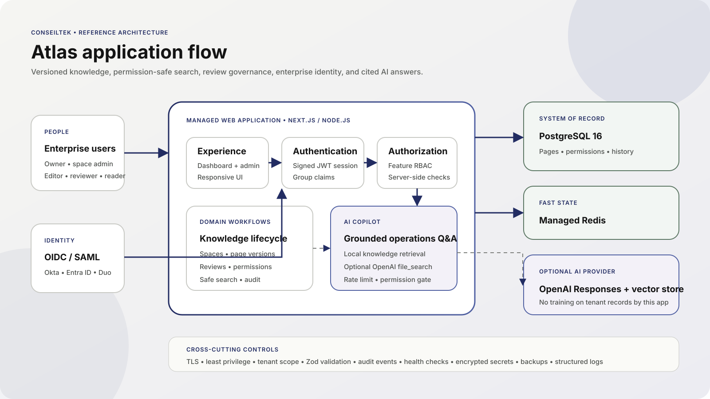
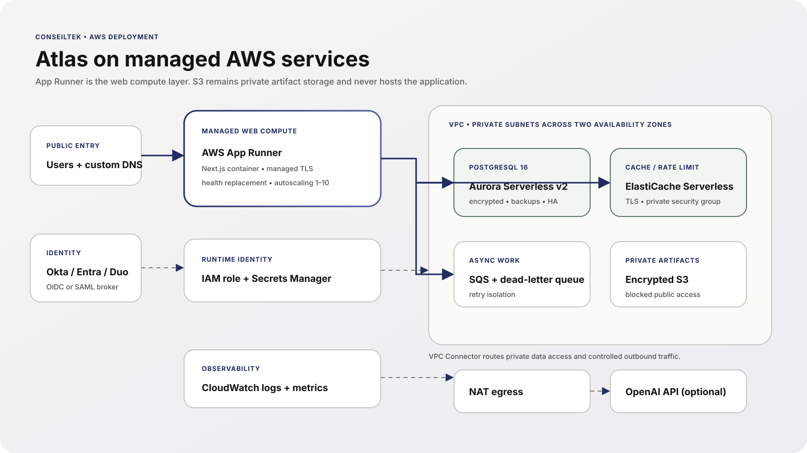
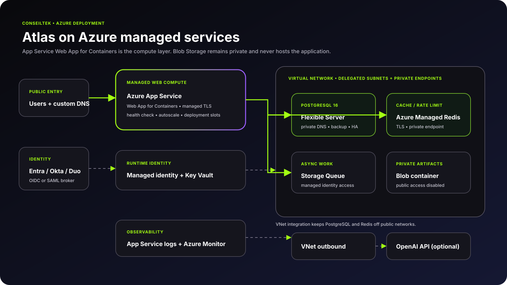

<div align="center">
  
  <h1>Atlas</h1>
  <p><strong>A knowledge base whose search respects permissions.</strong></p>
  <p>Spaces and versioned pages · review ownership · enterprise SSO · configurable RBAC · grounded AI</p>
</div>

[](https://github.com/ConseilTek-Tektons/atlas/actions/workflows/ci.yml) [](https://github.com/ConseilTek-Tektons/atlas/actions/workflows/codeql.yml) [](LICENSE)

Atlas helps teams write, review, discover, and trust operating knowledge without leaking restricted page titles or AI context. Permissions are applied before search results, counts, snippets, or citations leave the server. This is a working deployment package: application, PostgreSQL schema, enterprise identity, tests, container, and two managed-cloud architectures.



## Working capabilities

- Nested spaces and pages, immutable versions, structured blocks, comments, attachments, labels, templates, reviews, groups, and audit history
- Permission-safe page API and search utility that filter access before ranking
- Configurable roles for owners, administrators, space administrators, editors, reviewers, readers, and auditors
- OIDC for Okta or Microsoft Entra ID; SAML providers including Duo connect through Keycloak or another OIDC broker
- Knowledge copilot grounded only in readable approved pages, with citations and no content or permission mutation tools
- ConseilTek-branded dashboard, working create-page interaction, access-policy editor, health endpoint, and responsive layout
- Docker Compose plus AWS Terraform and Azure Bicep deployment paths

## Run locally

```bash
cp .env.example .env
docker compose up --build
```

Open [http://localhost:3000](http://localhost:3000); Keycloak runs on port 8080. For manual development use `pnpm install`, `pnpm db:migrate`, `pnpm db:seed`, and `pnpm dev`.

## Managed cloud deployment

Atlas requires server-side access checks, transactions, SSO callbacks, and retrieval orchestration, so it must not be deployed as a static web application.

| Cloud | Managed web runtime | PostgreSQL | Cache | Deployment |
|---|---|---|---|---|
| AWS | AWS App Runner | Aurora PostgreSQL Serverless v2 | ElastiCache Serverless | [Terraform](infra/aws/README.md) |
| Azure | Azure App Service Web App for Containers | PostgreSQL Flexible Server | Azure Managed Redis | [Bicep](infra/azure/README.md) |

These managed services reduce maintenance for compute replacement, TLS, scaling, database backup and patching, and cache operations. Private object storage holds page attachments; App Runner or App Service hosts the application.





## Operate and extend

- [Architecture](docs/ARCHITECTURE.md) · [Authentication](docs/AUTHENTICATION.md) · [RBAC](docs/RBAC.md)
- [AI and RAG](docs/AI.md) · [Security](docs/SECURITY.md) · [Operations](docs/OPERATIONS.md)
- Quality gate: `pnpm check`, Terraform validation, Bicep compilation, and an OCI container build

## Ownership

Atlas is designed, built, and maintained by [ConseilTek](https://conseiltek.com) and licensed under Apache 2.0. ConseilTek trademarks and supplied brand artwork are not granted by the source-code license. Contact [support@conseiltek.com](mailto:support@conseiltek.com).
