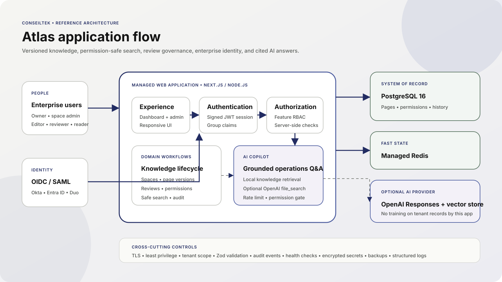

# Atlas architecture

Atlas is a modular knowledge application in one independently deployable container. PostgreSQL owns pages, versions, groups, permissions, and audit history; object storage holds attachments; Redis supports distributed request controls.

## Request, search, and answer flow

1. App Runner or App Service accepts HTTPS and OIDC callbacks, then NextAuth establishes a signed session.
2. Tenant group claims map to configurable application roles, while page and space grants provide content-level authorization.
3. A page write creates the page and immutable first version in one transaction. Later restoration appends a version rather than deleting history.
4. Search first applies tenant scope and live readable-page permissions. Ranking then operates only over those allowed candidates.
5. Titles, snippets, hit counts, autocomplete, and AI context all use the same permission-filtered candidate set.
6. The knowledge copilot rechecks access, retrieves approved content, and cites each supporting page. It has no editing or access-management tools.

## Bounded modules

| Module | Owns |
|---|---|
| Content | spaces, pages, versions, blocks, attachments, comments |
| Governance | owners, reviews, publishing, templates, labels, page history |
| Authorization | directory groups, page/space grants, feature RBAC, audit |
| Discovery | PostgreSQL full-text index, permission-safe ranking, optional vector retrieval |
| Platform | enterprise identity, health, cache, object storage, deployment |

## No-leak invariants

- Denied candidates do not influence returned titles, snippets, counts, ordering, or AI answers.
- Tenant scope is mandatory before any content-level permission evaluation.
- Content restoration creates a new numbered version.
- The assistant refuses unsupported questions and never reveals filtered-candidate metadata.

Atlas requires server-side permission checks and is not compatible with static website hosting. Managed App Runner/App Service compute reduces platform maintenance without weakening those checks.
